<div align="center">

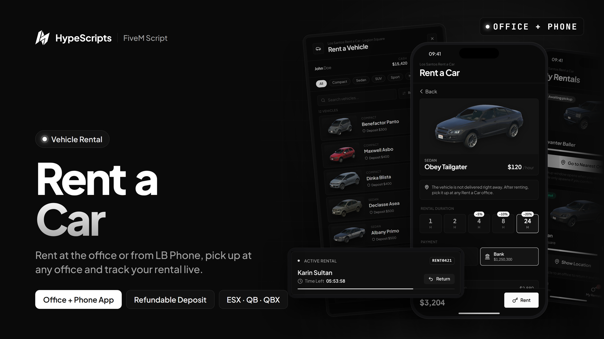

# hype-rentacar

**Vehicle rental offices for FiveM**

Players walk up to the clerk at a rental office, pick a vehicle, choose how long they want it and pay with cash or bank.
Every rental is timed, stored in the database, protected by a refundable deposit and recovered automatically when the time runs out.


[Features](#features) · [Screenshots](#screenshots) · [Installation](#installation) · [Configuration](#configuration) · [Usage](#usage) · [Developers](#developers)

</div>

---

## Features

| | |
| --- | --- |
| **Rental offices** | As many offices as you like, each with its own clerk ped, scenario, map blip, spawn points and vehicle list. Talk to the clerk through `ox_target`, `qb-target` or an <kbd>E</kbd> text prompt, while a camera turns to the clerk. |
| **Vehicle catalog** | Every vehicle with its image, category, price per hour and deposit. Browse by category tabs, search by name and sort by price or name. Cars, bikes, boats and other vehicle types are supported. |
| **Flexible durations** | Any rental duration in real-time hours, with a percentage discount for longer rentals. A live summary shows the base price, discount, rent, deposit and total before paying. |
| **Cash & bank** | Players pick the account they pay with and see both balances in the menu. Prices are always calculated on the server from the config. |
| **Refundable deposit** | Paid back when the vehicle is returned to an office, optionally reduced by engine and body damage. Choose whether expired rentals get their deposit back. |
| **Driver license check** | Checked through the framework (player metadata / `esx_license`), an inventory item or either one, or switched off completely. |
| **Active rentals** | The vehicle spawns with a unique rental plate, keys and a full tank, with the player behind the wheel. The office shows each rental with a live countdown and a return button. |
| **Automatic expiry** | Players are warned before their rental ends and expired vehicles are recovered. Remaining time carries over through server restarts. |
| **Respawn lost vehicles** | When a rented vehicle disappears while time is left, it can be respawned at the office, or next to the player from the phone, for a configurable fee. |
| **Companion phone app** | The optional [`hype-rentacar-app`](#phone-app-optional) adds an lb-phone app: rent remotely, collect the vehicle at any office, track rentals and bring a lost vehicle to you. |
| **Secure** | Vehicles, durations and accounts are checked against the config, office, pickup and spawn distances are verified, ownership is enforced, and cooldowns with request locks stop double clicks. Suspicious requests are logged. |

## Screenshots

<table>
  <tr>
    <td width="50%">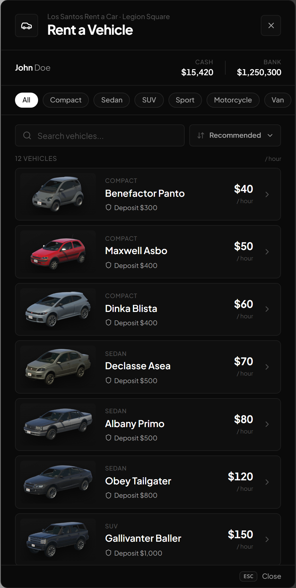</td>
    <td width="50%">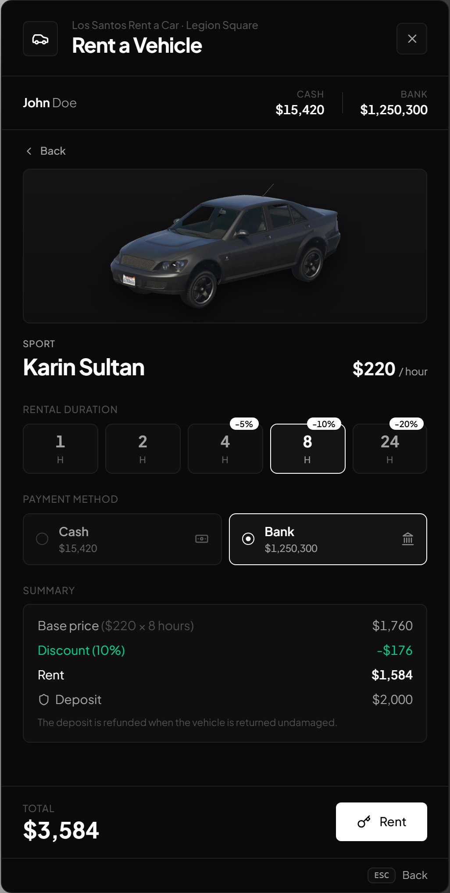</td>
  </tr>
  <tr>
    <td align="center"><sub>Rental office vehicle list</sub></td>
    <td align="center"><sub>Duration, payment and price summary</sub></td>
  </tr>
  <tr>
    <td>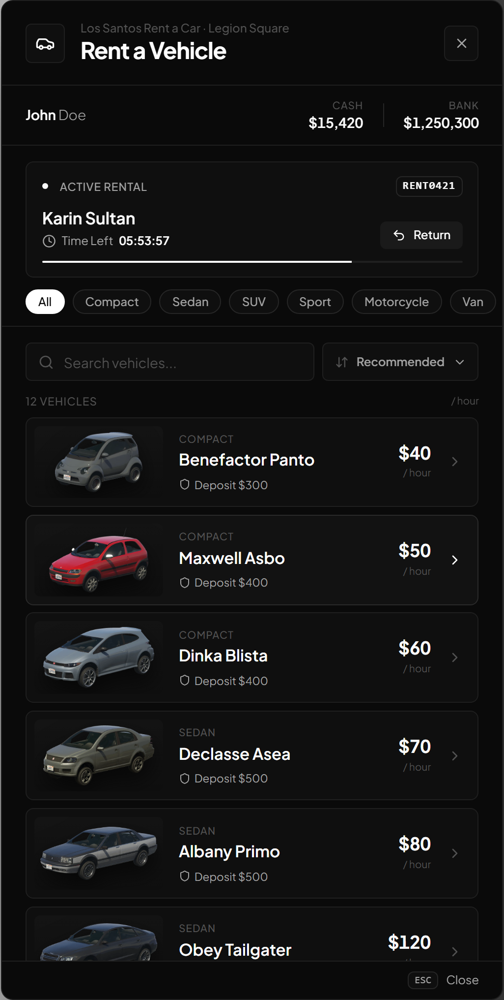</td>
    <td>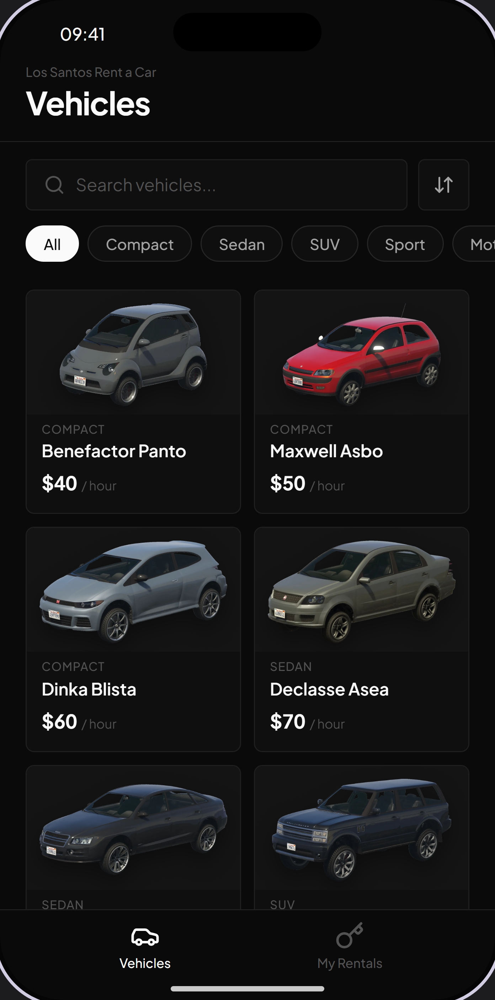</td>
  </tr>
  <tr>
    <td align="center"><sub>Active rental with live countdown</sub></td>
    <td align="center"><sub>Renting from the phone app</sub></td>
  </tr>
</table>

<details>
<summary><b>More screenshots</b></summary>
<br>

<table>
  <tr>
    <td width="50%">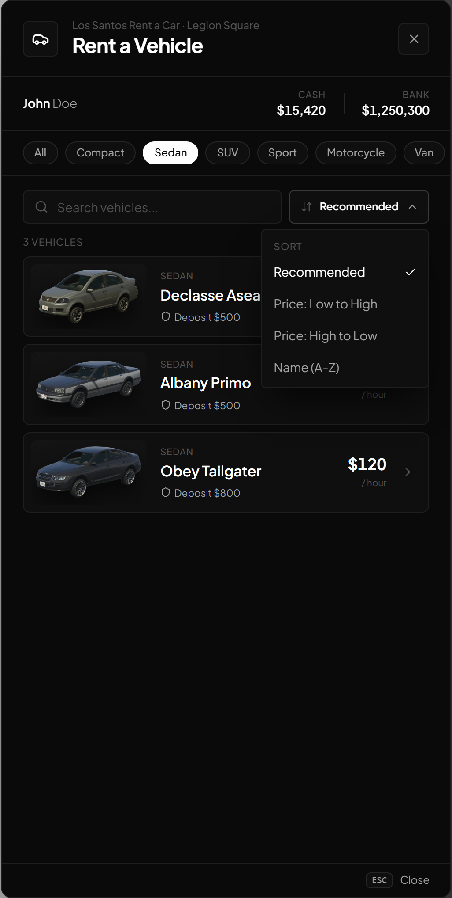</td>
    <td width="50%">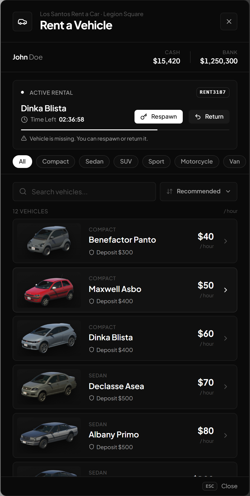</td>
  </tr>
  <tr>
    <td align="center"><sub>Category filter and sorting</sub></td>
    <td align="center"><sub>Missing vehicle, respawn or return</sub></td>
  </tr>
  <tr>
    <td>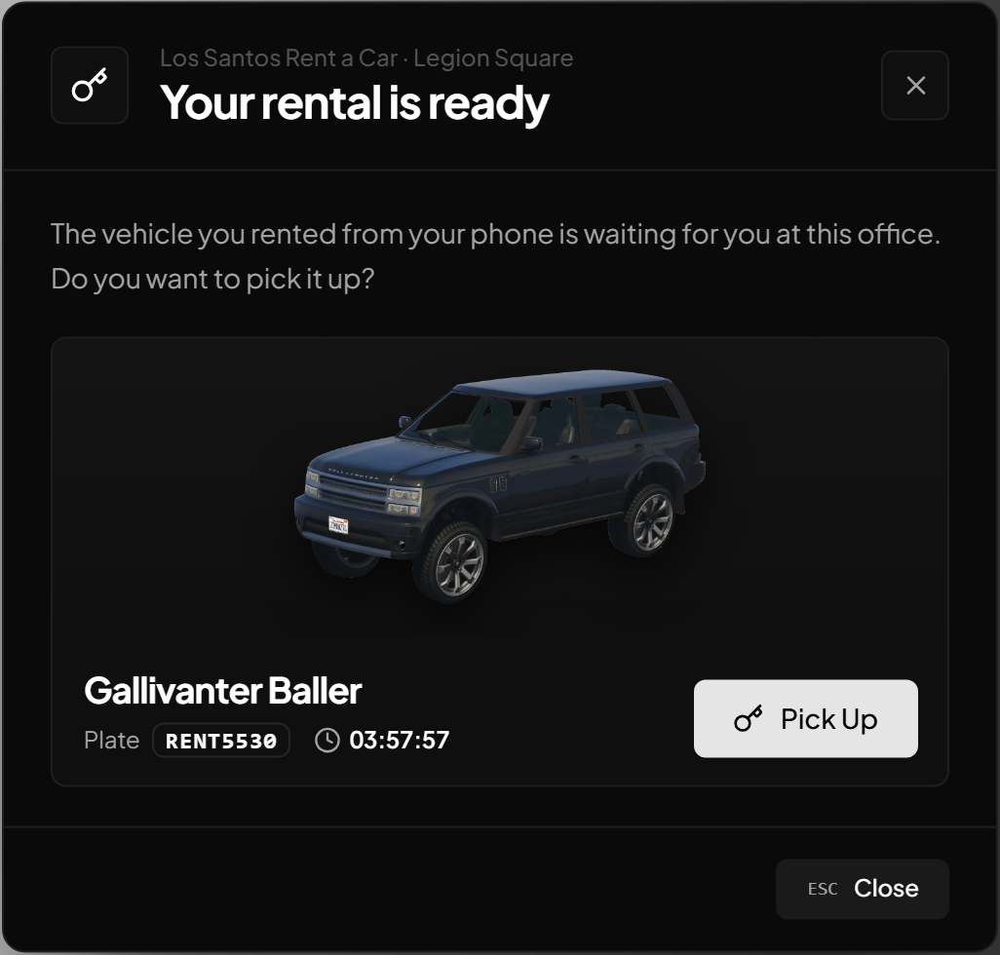</td>
    <td>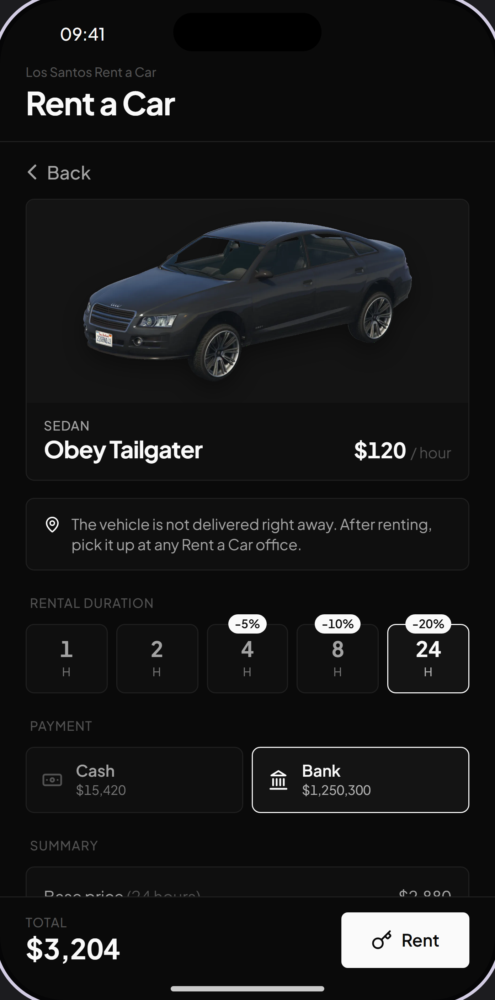</td>
  </tr>
  <tr>
    <td align="center"><sub>Collecting a phone rental at the office</sub></td>
    <td align="center"><sub>Phone app, vehicle details</sub></td>
  </tr>
  <tr>
    <td>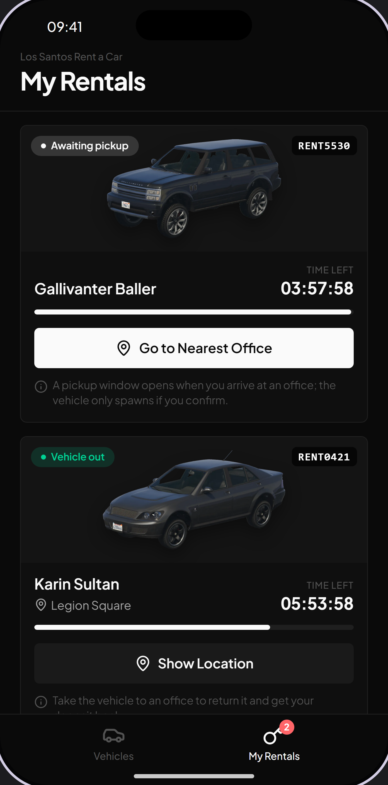</td>
    <td>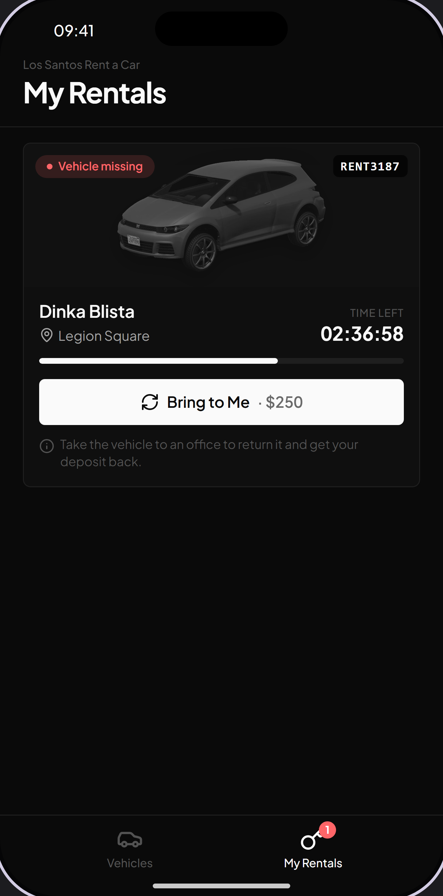</td>
  </tr>
  <tr>
    <td align="center"><sub>Phone app, My Rentals</sub></td>
    <td align="center"><sub>Bring a missing vehicle to you</sub></td>
  </tr>
  <tr>
    <td>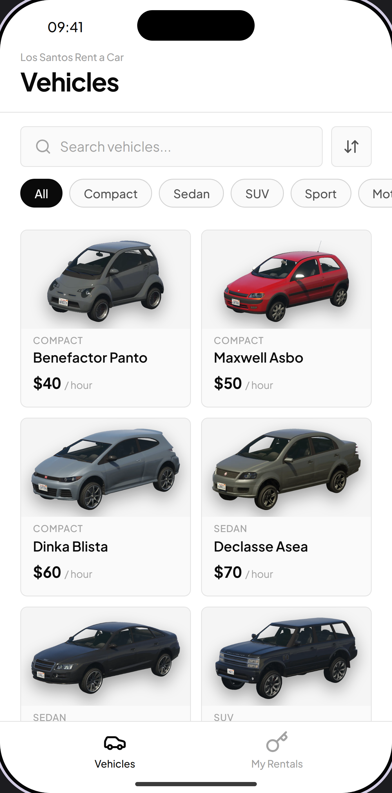</td>
    <td></td>
  </tr>
  <tr>
    <td align="center"><sub>Phone app, light theme</sub></td>
    <td></td>
  </tr>
</table>

</details>

## Requirements

| Type | Supported | Notes |
| --- | --- | --- |
| Required | [`ox_lib`](https://github.com/overextended/ox_lib/releases/latest), [`oxmysql`](https://github.com/overextended/oxmysql/releases/latest) | Hard dependencies |
| Framework | `qbx_core`, `qb-core`, `es_extended` | Detected in this order or forced in the config. One of them is required |
| Target | `ox_target`, `qb-target` | Optional, offices fall back to the <kbd>E</kbd> text prompt |
| Notifications | `okokNotify`, `ps-ui`, `ox_lib` | Picks the first one running, or forced in the config |
| Vehicle keys | `qbx_vehiclekeys`, `qb-vehiclekeys`, `wasabi_carlock`, `MrNewbVehicleKeys`, `qs-vehiclekeys`, `Renewed-Vehiclekeys` | Optional, detected in this order |
| Fuel | `ox_fuel`, `LegacyFuel`, `cdn-fuel`, `ps-fuel`, `lc_fuel` | Optional, detected in this order |
| Inventory | `ox_inventory`, `qb-inventory`, `ps-inventory`, `codem-inventory`, `core_inventory`, `jpr-inventory`, `origen_inventory`, `tgiann-inventory` | Only used for the license item check. Falls back to the framework inventory |
| Phone | [`lb-phone`](https://lbscripts.com/package/phone) + `hype-rentacar-app` | Optional, for phone rentals |

> [!NOTE]
> The license check reads `metadata.licences.<key>` on QBX / QB and the `user_licenses` table of `esx_license` on ESX.
> On ESX set `License.metadata = "drive"` (the default `"driver"` is the QB key).

## Installation

> [!IMPORTANT]
> The resource folder **must** be named `hype-rentacar`. Under any other name the script stops itself and prints a warning,
> and the phone app could not reach its exports.

**1. Download** or clone this repository and place it in your `resources` folder.

**2. Database:** run [`INSTALL/install.sql`](INSTALL/install.sql) on your database. It creates the `hype_rentacar_rentals` table, which is **not** created automatically.

**3. Start it** in `server.cfg`, after its dependencies:

```cfg
ensure ox_lib
ensure oxmysql
ensure qbx_core          # or qb-core / es_extended
ensure ox_target         # or qb-target (optional)
ensure hype-rentacar
```

**4. Configure** `config/config.lua`: at least the offices, vehicles and the license check (see below).

**5. Set the language** (`en` and `tr` included, add more in `locales/`):

```cfg
setr ox:locale "en"
```

### Phone app (optional)

`hype-rentacar-app` is a separate add-on resource that installs an lb-phone app. It has no rental logic of its own:
it forwards every phone request to the exports of this resource, and refreshes when this resource reports a change.
Start it after `lb-phone` and `hype-rentacar`:

```cfg
ensure lb-phone
ensure hype-rentacar
ensure hype-rentacar-app
```

Phone rentals are controlled here with `Remote` (renting from the phone) and `Respawn.remote` (bringing a lost vehicle next to the player).
The app listing (name, developer, price, default app) and the GPS options live in the app's own `config/config.lua`.

## Configuration

Everything lives in [`config/config.lua`](config/config.lua). The most important options:

| Option | Description |
| --- | --- |
| `Framework` / `Notifications` / `VehicleKeys` | `"auto"` or a forced resource (`VehicleKeys = false` disables keys) |
| `Fuel` | Fuel resource (`"auto"`, a resource or `false`) and the fuel level of rented vehicles |
| `CompanyName` | Shown in the UI header and as the notification title |
| `UI` | Accent color, money format locale and currency symbol |
| `ImageUrl` | Vehicle image URL (`%s` = model), overridden by a vehicle's own `image` |
| `PaymentAccounts` | Accounts players can pay with, in display order |
| `License` | Whether a license is required and how it is checked (`"metadata"`, `"item"` or `"any"`) |
| `MaxActiveRentals` / `PlatePrefix` | Rentals per player at the same time and the plate prefix (prefix + 4 digits) |
| `CheckInterval` / `ExpireWarning` | Expiry check interval (seconds) and the warning before a rental ends (minutes) |
| `Deposit` | Damage based deduction on return and whether expired rentals are refunded |
| `Respawn` | Respawning lost vehicles at the office and from the phone, the fee and the max phone spawn distance |
| `Remote` | Phone rentals: on / off, service fee and the pickup radius at the office |
| `Security` | Cooldown between actions and logging of suspicious requests |
| `Durations` | Rental durations in real-time hours with an optional discount |
| `Vehicles` | Rentable vehicles: model, label, category, price per hour, deposit, `type` and `image` |
| `Camera` | Camera facing the clerk while the menu is open (`false` = disabled) |
| `Locations` | Offices: clerk, interaction, distances, blip, spawn points and the vehicles offered |

<details>
<summary><b>Example: vehicles, durations and an office</b></summary>

```lua
Durations = {                              -- real-time hours, discount in percent
    { hours = 1 },
    { hours = 4,  discount = 5 },
    { hours = 24, discount = 20 },
},

Vehicles = {
    -- category: UI tab (locales -> ui.categories.<category>)
    -- type: CreateVehicleServerSetter type, defaults to automobile
    { model = "blista", label = "Dinka Blista",   category = "compact",    price = 60,  deposit = 400 },
    { model = "bati",   label = "Pegassi Bati 801", category = "motorcycle", price = 160, deposit = 1500, type = "bike" },
},

Locations = {
    {
        id = "legion",                     -- unique office id
        label = "Legion Square",
        coords = vec4(109.95, -1088.62, 29.30, 345.0), -- clerk position and heading
        model = "a_m_y_business_02",
        scenario = "WORLD_HUMAN_CLIPBOARD",
        interaction = "target",            -- "target" | "textui"
        interactDistance = 2.5,
        maxDistance = 10.0,                -- server check while renting / returning
        returnRadius = 30.0,               -- vehicle distance to the clerk to return it
        blip = { enabled = true, sprite = 225, color = 5, scale = 0.75 },
        spawns = {                         -- the first free one is used
            vec4(111.37, -1081.27, 28.79, 340.0),
            vec4(107.46, -1079.87, 28.79, 340.0),
        },
        vehicles = nil,                    -- models offered here, nil = every vehicle
    },
},
```

A new category only needs a label in `locales/*.json` under `ui.categories`.

</details>

## Usage

| Key / action | Description |
| --- | --- |
| Target or <kbd>E</kbd> at the clerk | Open the rental menu (not available while in a vehicle) |
| Select a vehicle | Choose the duration and payment account, then rent |
| **Return** | Return a rental at any office. The vehicle must be within the office's `returnRadius` |
| **Respawn** | Respawn a rental whose vehicle no longer exists, at the office spawn points |
| **Pick Up** | When a phone rental is waiting, talking to the clerk opens the pickup window first. The vehicle only spawns once confirmed |
| <kbd>ESC</kbd> | Back / clear the search / close the menu |

The interaction prompt only appears with `interaction = "textui"`, or with `"target"` when no target resource is running.
There are no commands.

## Developers

All exports are called through `exports["hype-rentacar"]`. These are the ones `hype-rentacar-app` uses.

| Export | Side | Description |
| --- | --- | --- |
| `IsOpen()` | client | Whether the rental menu is open |
| `Close()` | client | Close the rental menu |
| `GetCatalog()` | server | Vehicles, durations, offices, accounts and rental rules |
| `GetPlayerData(source)` | server | A player's info, license state and active rentals |
| `Rent(source, data)` | server | Phone rental (`{ model, hours, payment }`), collected later at an office. Returns `success, result` |
| `Respawn(source, rentalId, spawnPoint)` | server | Respawn a lost rental at `{ x, y, z, w }` next to the player. Returns `success, result` |

On failure `result` is an error code, the keys under `ui.errors` in the locale files (`no_money`, `no_license`, `max_rentals`, ...).

```lua
-- Client: fired whenever the player's rentals change (rent, pickup, return, respawn, expiry)
RegisterNetEvent("hype-rentacar:client:updated", function() end)
```

<details>
<summary><b>Bridge exports</b></summary>

The framework bridge and the modules are exported as well, e.g. `GetFrameworkObject()`, `GetModules(name?)`,
`SendNotify(...)` (both sides), `GiveKeys(source, vehicle, plate?, model?)`, `SetFuel(...)` (both sides) and `HasItem` / `GetItemCount` (server).
See the files in `frameworks/` and `modules/` for the full list and signatures.

</details>

<details>
<summary><b>Structure</b></summary>

```
config/config.lua        all settings: offices, vehicles, durations, rules
shared/                  config loader, locale, Debug
frameworks/              framework detection and qbx_core / qb-core / es_extended bridges
modules/fuel/            ox_fuel / LegacyFuel / cdn-fuel / ps-fuel / lc_fuel
modules/inventory/       license item check across inventories
modules/notify/          okokNotify / ps-ui / ox_lib
modules/target/          ox_target / qb-target
modules/vehiclekeys/     vehicle keys resources
client/                  clerks, blips, interaction, camera, NUI
server/                  renting, pickup, return, respawn, expiry, exports
INSTALL/install.sql      database table
locales/*.json           all texts (Lua and UI share the same files)
web/                     Vue 3 + TypeScript + Pinia + Tailwind (Vite)
```

</details>

<details>
<summary><b>Building the UI</b></summary>

The interface ships prebuilt in `web/build`. To modify it, edit the Vue source in `web/` and rebuild:

```bash
cd web
pnpm install
pnpm build
```

</details>

## License

Released under the [MIT License](LICENSE).

<div align="center">
<sub>Made by <b>HypeScripts</b></sub>
</div>
